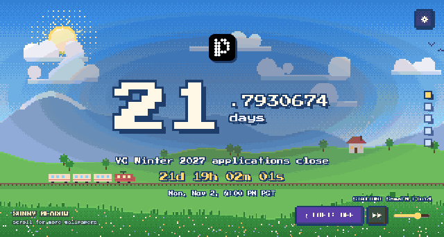
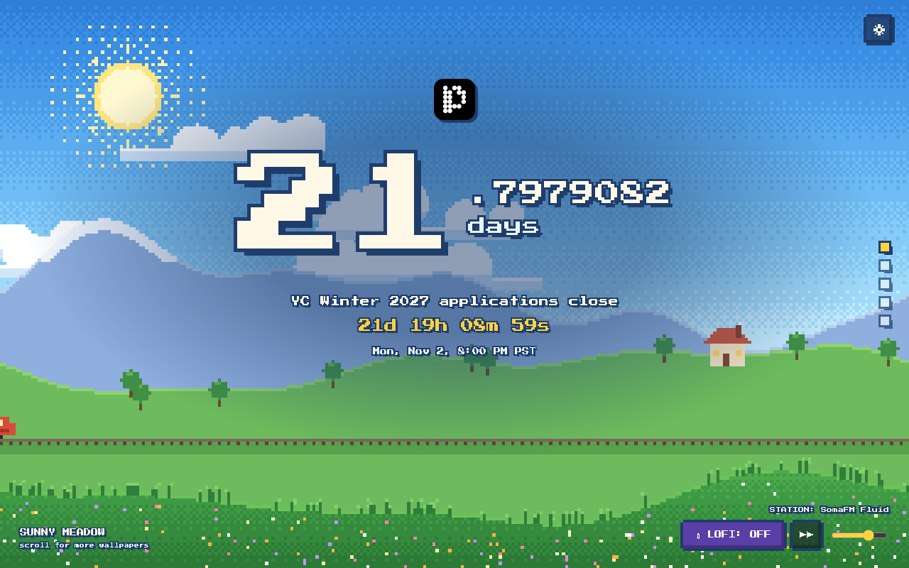
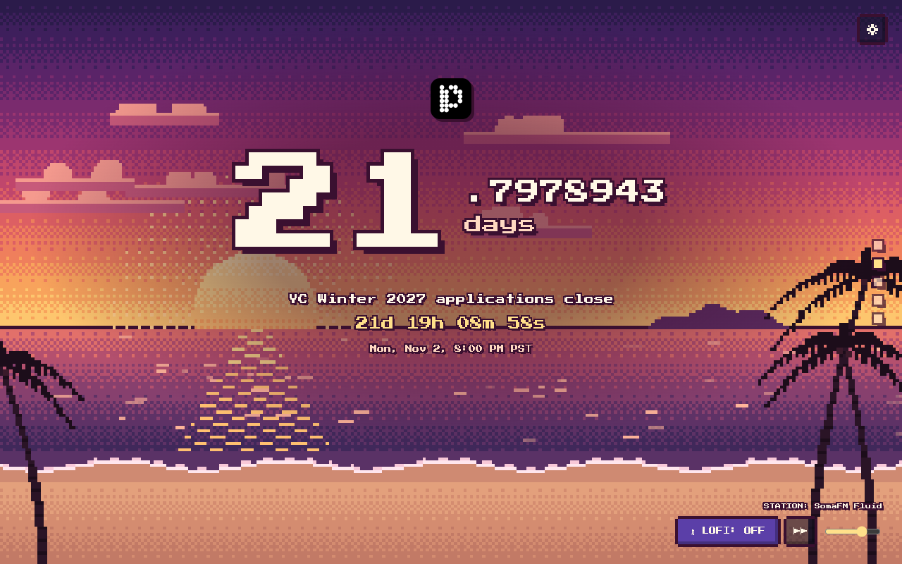
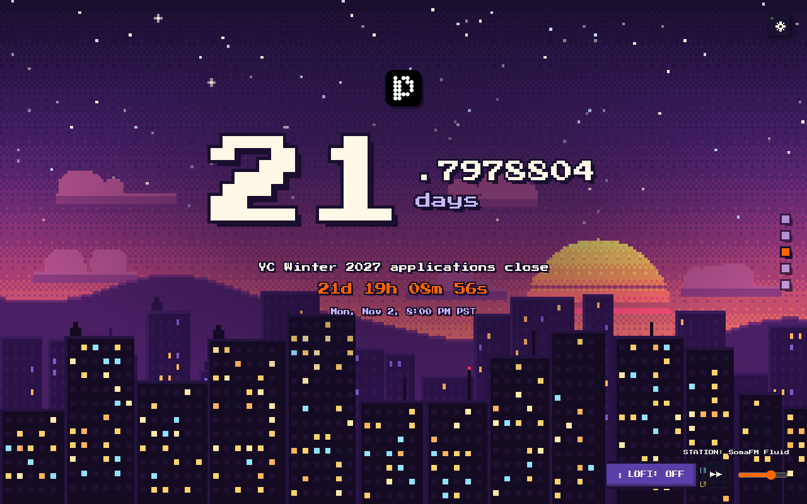
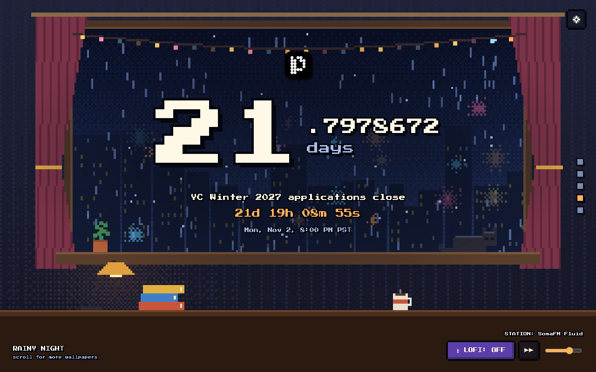
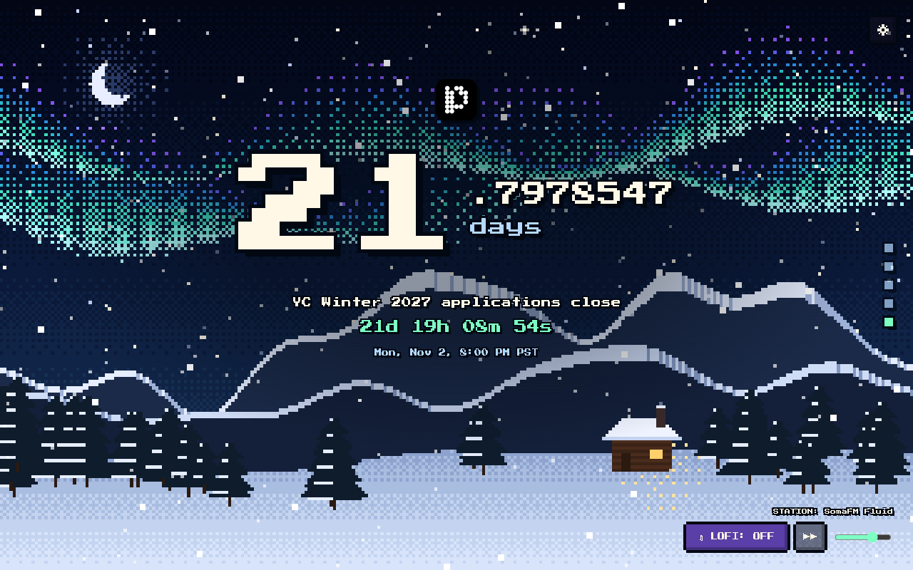

# Lofi Deadline Countdown

A Chrome extension that turns every new tab into an 8-bit lofi countdown to
your deadline. It's set to the **YC Winter 2027 application deadline (Mon,
Nov 2 2026, 8:00 PM PT)** out of the box.



- **Countdown:** a ticking fractional-days counter (`21.7930370 days`) plus a
  `d h m s` readout. The toolbar badge shows the days left.
- **5 animated pixel wallpapers.** Scroll, use the arrow keys, or click the dots
  on the right to switch:

  | Sunny Meadow | Golden Beach | Neon Dusk |
  | --- | --- | --- |
  |  |  |  |
  | **Rainy Night** | **Aurora Cabin** | |
  |  |  | |

  By default it picks one for the time of day.
- **Live lofi radio.** Hit **LOFI** (bottom right) to stream. **▶▶** switches
  stations. Music keeps playing while you browse, until you turn it off.
- **Make it yours.** The ⚙ button (top right) lets you upload your own logo and
  set your own title and deadline. Settings stay in your browser.

## Install

1. **[Download the zip](https://github.com/ebaad11/extention-deadline-yc/releases/latest/download/lofi-deadline-countdown.zip)**
   and unzip it.
2. Open `chrome://extensions` and turn on **Developer mode** (top right).
3. Click **Load unpacked** and select the unzipped `lofi-deadline-countdown` folder.
4. Open a new tab. If Chrome asks whether to keep the new-tab change, choose **Keep it**.

Keep the folder somewhere permanent. Chrome loads the extension from it, so
deleting the folder removes the extension.

**Updating:** download the new zip, replace the folder, then click ↻ on the
extension in `chrome://extensions`. Your settings are kept.

> No release yet? Use **Code → Download ZIP** on GitHub, unzip it, and load
> the `extension` folder in step 3 instead.

## Radio stations

| Station | Style |
| --- | --- |
| [SomaFM Fluid](https://somafm.com/fluid/) | Instrumental hip-hop |
| [laut.fm Lofi](https://laut.fm/lofi) | Lofi hip-hop |
| [FluxFM Chillhop](https://www.fluxfm.de/) | Chillhop |
| [I Love Chillhop](https://www.ilovemusic.de/) | Chillhop |
| [SomaFM Groove Salad](https://somafm.com/groovesalad/) | Ambient downtempo |
| Offline beat | Generated in the browser, works without internet |

The stations are free, listener-supported internet radio. SomaFM runs on
donations, so if you like it, [support them](https://somafm.com/support/).

## Development

The extension lives in `extension/`, with no build step and no dependencies.

- `config.js`: default deadline, presets and radio stations
- `scenes/`: one file per wallpaper (`pixel.js` has the shared drawing
  helpers, `engine.js` handles switching)
- `background.js` + `offscreen.*` + `player.js`: badge and background music
- `lofi.js`: the offline synthesized beat

You can open `extension/newtab.html` straight from disk to iterate on visuals.
Add `#aurora` (or any scene id) to the URL to jump to a wallpaper.

### Releasing

```sh
./build.sh                       # -> dist/lofi-deadline-countdown.zip
git tag v2.0.0 && git push --tags  # GitHub Action publishes the release
```

## Credits

Pixel font: [Press Start 2P](https://fonts.google.com/specimen/Press+Start+2P)
by CodeMan38 (SIL Open Font License, see `extension/fonts/OFL.txt`).
Not affiliated with Y Combinator.
